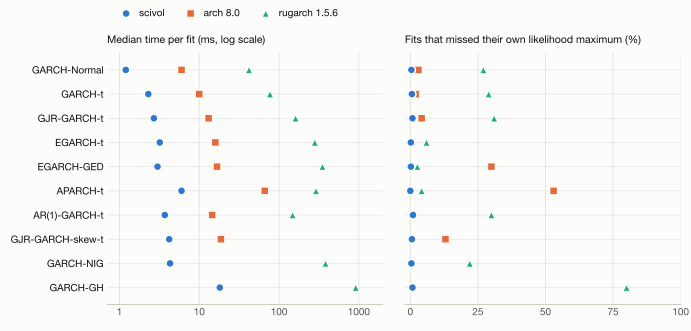
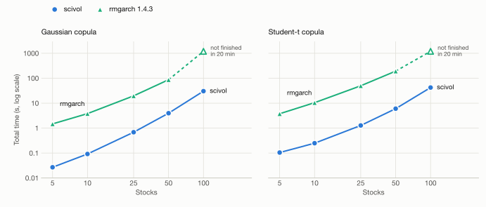

# Benchmarks

This page compares scivol with Python's `arch` and R's `rugarch` and `rmgarch` on real stock returns. It reports two things for each library: how long a fit takes, and whether the fit reaches the maximum of that library's own likelihood. A fast fit that stops short of the maximum is not a good fit, so the second measure matters as much as the first.

The results describe one machine, one data source and each library's default settings. They are evidence, not a universal speed ratio.

## Setup

| | |
| --- | --- |
| Machine | Apple M4 Mac mini (4 performance cores), macOS |
| Parallelism | 4 worker processes, one fit at a time per process, single-threaded BLAS |
| scivol | Current defaults: `coordinates="automatic"`, `starts="auto"` |
| arch | 8.0.0, compiled recursions, its default starting-value grid and SLSQP |
| rugarch, rmgarch | 1.5.6 and 1.4.3 on R 4.5.3, default `"hybrid"` solver |
| Timing | Wall time around each library's fit call |
| Date | 2026-10-30 |

**Data.** CRSP daily stock returns, as log returns in percent; each stock contributes its last 2,500 observations. The *liquid panel* has 500 randomly drawn stocks with at most 5% zero returns. The *illiquid panel* has 200 stocks with more than 25% zero returns.

**Models.** Ten univariate models, each with zero mean unless stated. arch has no generalized hyperbolic densities, so GARCH-NIG and GARCH-GH are compared with rugarch only. rugarch's skewed Student-t is a different density from Hansen's (1994), so GJR-skew-t is compared with arch only.

## How likelihoods are compared

The libraries start their variance recursions differently (scivol uses the sample mean square, arch a backcast, rugarch the mean of squared residuals), so their reported log-likelihoods differ by amounts unrelated to fit quality. Raw likelihoods are therefore not compared.

Instead, every estimate is translated into each other library's parameterization and evaluated in that library's own likelihood. A library **missed its own maximum** on a fit when another library's estimate scores more than 0.01 higher in the first library's likelihood than its own reported estimate. A rival estimate counts only if it lies in the closure of scivol's declared domain; for example, an estimate with persistence above one does not count against scivol's covariance-stationary model.

A miss is evidence that a better point exists, not a measure of how far a fit is from the global maximum, which none of the libraries can guarantee.

"Certified" (scivol) and "converged" (arch, rugarch) mean different things. scivol certifies a fit only when the first-order conditions hold in the original parameter domain; the other libraries report their optimizers' termination codes.

## Liquid panel

<picture>
  <source media="(prefers-color-scheme: dark)" srcset="images/benchmark-univariate-dark.svg">
  
</picture>

Median time per fit in milliseconds, and the share of fits that missed the library's own maximum:

| Model | scivol ms | arch ms | rugarch ms | scivol missed | arch missed | rugarch missed |
| --- | ---: | ---: | ---: | ---: | ---: | ---: |
| GARCH(1,1)-Normal | 1.2 | 6.0 | 42 | 0.4% | 3.0% | 27% |
| GARCH-t | 2.3 | 10.0 | 77 | 0.6% | 2.0% | 29% |
| GJR-GARCH-t | 2.7 | 13.1 | 161 | 0.8% | 4.2% | 31% |
| EGARCH-t | 3.2 | 15.9 | 281 | 0.2% | 0.4% | 6.0% |
| EGARCH-GED | 3.0 | 16.7 | 350 | 0.2% | 30% | 2.6% |
| APARCH-t | 6.0 | 66.2 | 290 | 0.0% | 53% | 4.2% |
| AR(1)-GARCH-t | 3.7 | 14.5 | 148 | 1.0% | 0.8% | 30% |
| GJR-GARCH-skew-t | 4.2 | 18.7 | — | 0.6% | 13% | — |
| GARCH-NIG | 4.3 | — | 382 | 0.4% | — | 22% |
| GARCH-GH | 18.1 | — | 915 | 0.8% | — | 80% |

Across the shared fits, the median per-fit time ratio to scivol is 4.9 for arch and 53 for rugarch.

scivol certified every fit for nine of the ten models and 73% of GARCH-GH fits; the uncertified GH fits are mostly likelihoods that keep rising toward a limit outside the parameter space. arch reported convergence on 98–100% of fits per model, rugarch on 99–100%.

Most of scivol's remaining misses are separate local maxima that its candidate starts do not reach (see [multi-start](estimation.md#multi-start)). Before multi-start, scivol missed its maximum on about 4% of GARCH-Normal and GJR-t fits; the automatic start race reduced the misses on this panel from 114 to 38 of 5,000 fits, at 17% more total time.

## Illiquid panel

Stocks that rarely trade have many returns of exactly zero. With exact zeros, peaked densities and collapsing variances can make the likelihood unbounded, so many of these fits have no maximum to find. scivol reports such fits as uncertified (or, when no finite estimate exists, raises [`FitError`](api.md)). arch and rugarch usually report convergence on the same fits while missing their own maxima on up to 48% (arch) and 91% (rugarch) of fits per model. rugarch's solver could run for an hour on a single fit and needed a hard 60-second limit; 28 EGARCH-GED fits reached it.

These fits are not a fair speed test, so no timings are reported for them.

## DCC

The DCC comparison uses an aligned panel of liquid stocks over 2,516 trading days (2015-01-02 to 2024-12-31), with five random draws of 5, 10, 25, 50 and 100 stocks. Each pipeline fits GARCH(1,1) marginals and then DCC(1,1), single-threaded:

| Copula | Marginals | rmgarch call |
| --- | --- | --- |
| Gaussian | GARCH-Normal | `dccfit` with `mvnorm` |
| Student-t | GARCH-t | `cgarchfit` with a parametric `mvt` copula |

<picture>
  <source media="(prefers-color-scheme: dark)" srcset="images/benchmark-dcc-dark.svg">
  
</picture>

Median total time in seconds; ">1200" means the run did not finish within the 20-minute limit.

| Stocks | Gaussian: scivol | Gaussian: rmgarch | Student-t: scivol | Student-t: rmgarch |
| ---: | ---: | ---: | ---: | ---: |
| 5 | 0.03 | 1.5 | 0.11 | 3.8 |
| 10 | 0.09 | 3.8 | 0.25 | 10.5 |
| 25 | 0.69 | 19.7 | 1.28 | 49.9 |
| 50 | 3.97 | 87.3 | 6.03 | 193 |
| 100 | 30.4 | >1200 | 42.4 | >1200 |

Every scivol DCC fit and every marginal certified. rmgarch's estimates were evaluated in scivol's correlation likelihood; none scored higher than scivol's. The Gaussian-copula likelihood often has two maxima in the persistence parameter b (near 0.8 and near 0.98), which is why scivol's DCC [candidate starts](estimation.md#multi-start) include both regions.

## Limits of this comparison

- One machine, one data source, default settings for every library. Other data, tolerances or starting values change both times and miss rates.
- Timings include each library's own overhead (Python for scivol and arch, R for rugarch and rmgarch).
- The miss measure only detects points that some library found; it cannot detect a maximum none of them reached.
- rugarch and rmgarch timings come from the same day's runs with the same panels; scivol and arch were rerun with the final defaults.

